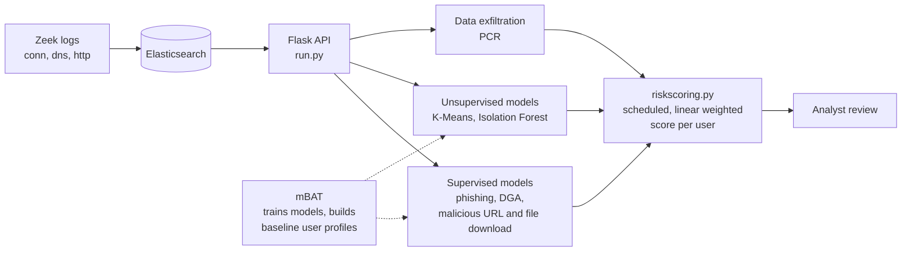

<p align="center"></p>

# User Entity Behavior Analytics (UEBA) Project

## Overview

This project is a Flask-based application that focuses on User Entity Behavior Analytics (UEBA). It provides a set of APIs designed to connect with Elasticsearch for data retrieval and response generation. The project relies on Zeek (formerly known as Bro) as a primary data source and emphasizes its use.

## How it fits together



## Data Source: Zeek (Bro)

The project leverages Zeek data as the primary source of information. Zeek provides valuable data on network traffic and behavior, making it a critical component of this project.

## Models

The project incorporates a range of models, both supervised and unsupervised, to analyze user entity behavior. These models are designed for various UEBA purposes:

### Supervised Models

1. Phishing Detection: Detects phishing attempts and fraudulent activity.

2. DGA (Domain Name Generative Adversarial Attack) Detection: Identifies domain names associated with malicious activities.

3. Malicious URL Detection: Flags URLs that may be involved in malicious activities.

4. Detection of Malicious File Downloads: Monitors and identifies any attempts to download malicious files via URLs.

### Unsupervised Models

1. K-Mean Clustering: Utilizes K-Means clustering to group related data points.

2. Isolation Forest: Emphasizes the use of Isolation Forest for anomaly detection.

### Data Exfiltration

The project includes models for data exfiltration analysis, including:

- PCR (Producer-Consumer Ratio): Measures the ratio of data packets flowing in and out, providing insights into data exfiltration.

### Risk Scoring Module

The project features a risk scoring module that assesses the risk associated with user behaviors. This module takes input from all other modules and employs a linear weighted equation to calculate a risk score for each user. The risk score helps in prioritizing and identifying potentially high-risk entities.

## mBAT Submodule

Within the project, there is a submodule known as mBAT, which is responsible for two essential tasks:

1. Training New Models: mBAT facilitates the training of new UEBA models, ensuring the system stays updated with the latest data.

2. Creating Baseline User Profiles: It generates baseline profiles for users, helping in user behavior analysis.

## Usage

```
python run.py 
```
###
BlockingScheduler
```
python riskscoring.py
```
## Dependencies
```
elasticsearch==7.10.1
swifter==0.305
six==1.12.0
pysafebrowsing==0.1.1
requests==2.22.0
tld==0.9.6
tensorflow==2.2.0
pandas==1.2.1
waitress==1.4.4
pyod==0.8.8
APScheduler==3.7.0
numpy==1.19.5
joblib==0.15.1
crawlerdetect==0.1.4
tldextract==2.2.2
Flask==1.1.1
zat==0.4.3
user_agents==2.2.0
mysql_connector_repackaged==0.3.1
python_Levenshtein==0.12.2
scikit_learn==0.24.2

```
## Portfolio notes

Architecture: Zeek logs -> feature preparation -> supervised and unsupervised models -> risk scoring -> analyst review.

Examples should use sample or authorised data only.

Limitations: model quality depends on log coverage, labelling and environment specific baselines.

## Visual assets

The banner illustration was generated from a written brief (`docs/assets/briefs/`, with the references it drew on); its sidecar `docs/assets/hero-art.png.json` records the prompt. Text is set in real type by `docs/assets/tools/compose_banner.py`. `docs/assets/social-preview.jpg` (1280x640) is for the repository's social preview.
